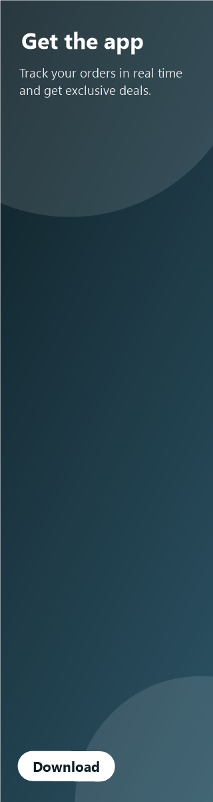

# Custom Ads Widget

A Flutter package for building and displaying **non-intrusive custom ads** on the web. It renders your own banners or template-based ads, loads them from a remote JSON, and tracks impressions and clicks.

## Overview

This package handles the ad side of a Flutter Web app, so you don't have to build it from scratch. Your client (or your own backend) publishes a JSON file with banners, images, links and schedules. You drop an `AdSlot` wherever an ad should appear, and the package takes care of the rest:

- choosing the right image for the screen size;
- rotating ads;
- respecting start and end dates;
- opening the link when the user clicks;
- reporting viewable impressions.

Every ad follows a built-in **non-intrusive policy** based on the [Better Ads Standards](https://www.betterads.org/standards/) and the [Acceptable Ads](https://acceptableads.com/standard/) criteria:

- each ad is always labeled;
- its size is capped;
- animations are frozen;
- rotation is slow.

There are no pop-ups, interstitials, sticky ads, video or sound.

## Features

This package includes the following widgets and classes.

### AdSlot

The main widget. It shows the ads for one **placement** (a named spot on the page, such as `home_top` or `sidebar`) defined in the remote JSON.

- Reads from the `RemoteAdSource` provided by `CustomAdScope`, or from one passed directly.
- Shows a single ad, or rotates them automatically when the placement has several.
- Skips ads outside their `startAt` / `endAt` dates.
- Renders nothing (or an optional `placeholder`) when the placement doesn't exist, has no active ads, or the JSON fails to load, so empty slots never leave a gap.
- Accepts a `builder` to draw remote ads with your own design.

### CustomAd

A single ad, built from an `AdData` and shown in any `AdFormat`.

- **Six formats:**
  - `creative`: your own image, as designed;
  - `leaderboard`: 728x90;
  - `mediumRectangle`: 300x250;
  - `skyscraper`: 160x600;
  - `card`: fluid width;
  - `hero`: full width.
- **Hover effects for the web:** click cursor, elevation and a slight scale.
- **Clicks:** a click opens `targetUrl`, in a new tab by default.
- **Viewable impressions:** an impression counts when at least 50% of the ad stays visible for 1 second (the IAB criterion), once per mounted ad.
- **Optional close button** (`dismissible`).
- **Fully custom content** through `builder`, while keeping clicks, tracking, sizing and policy enforcement.

### CustomAdRotator

Rotates a list of ads in the same space.

- Fades between ads at a fixed interval, with a minimum of 30 seconds.
- Pauses while the mouse is over it, so the ad doesn't change right before a click.
- Closing any ad hides the whole rotator.

### CustomAdScope

Shared configuration for every ad below it. Place it once at the top of your app.

- `source`: the `RemoteAdSource` that every `AdSlot` reads from.
- `style`: the default `AdStyle` for template ads.
- `policy`: the thresholds of the non-intrusive policy.
- `onImpression` / `onClick`: one place to connect your analytics.
- `CustomAdScope.merge(...)` overrides some values for one section of the page and inherits the rest.

### RemoteAdSource

Downloads and keeps the ads JSON up to date.

- One instance is shared by every `AdSlot`, and simultaneous requests are merged into one.
- Optional `refreshInterval` to pick up new banners without reloading the page.
- If a reload fails, it keeps showing the last valid configuration.
- Relative image and link URLs are resolved against the JSON URL.
- Optional `headers`, for example an API key.
- Exposes `config`, `error`, `isLoading`, `ensureLoaded()` and `reload()`.

### AdData and AdAsset

The content of an ad, independent of how it is drawn.

- Text fields for template ads: `title`, `description`, `ctaLabel` and `sponsor`.
- `assets`: one image per size for `creative` banners. The widest one that fits is used.
- Click destination (`targetUrl`), label (`badge`) and schedule (`startAt` / `endAt`).
- `AdData.fromJson` / `toJson` for loading ads from any API.

### AdStyle

Controls the look of template ads. Values you don't set come from your app's `ColorScheme`, so ads also adapt to dark mode.

- Background color or gradient, text and accent colors, border, corner radius, elevation and hover scale.
- Ready-made styles:
  - `AdStyle.dark()`: dark background;
  - `AdStyle.vibrant(color)`: gradient based on one color;
  - `AdStyle.creative`: no rounded corners or zoom, the default for image banners.
- `copyWith` to adjust any of them.

### AdPolicy

The non-intrusive rules. They are always on. You can change the thresholds, but not turn the rules off.

- Every ad shows a label: `badge`, or the policy `label` when the ad has none.
- Landscape and rectangular ads are scaled down if taller than 30% of the screen.
- Vertical ads count as side ads. They only show on screens at least 1024px wide, and at most 350px wide.
- Animated GIF, WebP and PNG images are frozen on their first frame.
- Rotation is never faster than every 30 seconds.

### Building blocks

`AdImage`, `AdCta` and `AdMetaLine` are the parts the built-in layouts use. Use them in your own `builder` designs. `AdImage` also freezes animations, so prefer it over `Image.network`.

## Supported Formats

| Format | Size | Behavior |
|---|---|---|
| `creative` | Taken from the image (`assets`) | Shows the advertiser's own banner as-is. Picks the widest asset that fits the space and the policy. |
| `leaderboard` | 728x90 | Switches to a 320x50 mobile banner below 728px of width. |
| `mediumRectangle` | 300x250 | Default format. Image on top, text and button below. |
| `skyscraper` | 160x600 | Vertical side ad, shown on desktop only (see `AdPolicy`). |
| `card` | Fluid width | 16:9 image plus text. Ideal for feeds and grids. |
| `hero` | Full width | Image as background with a dark overlay and large text. |

Fixed sizes follow the IAB standard units. They shrink when the container is narrower, and never stretch.

## Properties per Widget

| Widget | Properties |
|---|---|
| `AdSlot` | `placement`: **(required)** placement ID from the JSON.<br>`source`: `RemoteAdSource` to read from (defaults to the one in `CustomAdScope`).<br>`style`: `AdStyle` for template ads.<br>`builder`: custom design for this slot's ads.<br>`placeholder`: widget shown when there is nothing to display. |
| `CustomAd` | `ad`: **(required)** the `AdData` to show.<br>`format`: `AdFormat` (default `mediumRectangle`).<br>`style`: `AdStyle` (defaults to the scope's, or `AdStyle.creative` for `creative`).<br>`builder`: `(context, ad, style, hovered) => Widget` for fully custom content.<br>`onTap`, `onImpression`, `onClose`: per-ad callbacks.<br>`dismissible`: shows a close button (default `false`).<br>`openInNewTab`: opens `targetUrl` in a new tab (default `true`). |
| `CustomAdRotator` | `ads`: **(required)** non-empty list of `AdData`.<br>`interval`: time between ads (default and minimum: 30 s).<br>`format`, `style`, `builder`, `dismissible`, `onTap`, `onImpression`: same as `CustomAd`. |
| `CustomAdScope` | `child`: **(required)** the subtree.<br>`source`: `RemoteAdSource` for every `AdSlot`.<br>`style`: default `AdStyle`.<br>`policy`: `AdPolicy` thresholds (default `AdPolicy.nonIntrusive`).<br>`onImpression`, `onClick`: global analytics callbacks. |
| `RemoteAdSource` | `url`: **(required)** URL of the ads JSON.<br>`refreshInterval`: reload the JSON periodically.<br>`headers`: extra request headers.<br>`client`: custom `http.Client` (handy for tests). |
| `AdData` | `id`: **(required)** used for tracking.<br>`title`: **(required)** visible title, or alt text for `creative`.<br>`description`, `imageUrl`, `sponsor`: template content.<br>`ctaLabel`: button text (default `'Learn more'`).<br>`assets`: list of `AdAsset(url, width, height)` for `creative`.<br>`targetUrl`: click destination.<br>`badge`: label text (default `'Ad'`).<br>`startAt`, `endAt`: schedule. |
| `AdStyle` | `backgroundColor`, `gradient`, `foregroundColor`, `accentColor`, `onAccentColor`, `border`, `titleStyle`, `descriptionStyle`.<br>`borderRadius`: default `12`.<br>`elevation`: default `1`.<br>`hoverElevation`: default `6`.<br>`hoverScale`: default `1.015`. |
| `AdPolicy` | `label`: label for ads without a `badge` (default `'Ad'`).<br>`maxViewportHeightFraction`: maximum ad height relative to the screen (default `0.3`).<br>`minViewportWidthForVerticalAds`: default `1024`.<br>`maxVerticalAdWidth`: default `350`.<br>`minRotationInterval`: default 30 s. |

## Remote JSON

The client publishes one JSON file over HTTPS. Each key in `placements` matches an `AdSlot(placement: ...)` in the app:

```json
{
  "version": 1,
  "placements": {
    "home_top": {
      "rotationSeconds": 30,
      "ads": [
        {
          "id": "summer-2026",
          "alt": "Summer sale: 50% off",
          "targetUrl": "https://example.com/summer",
          "endAt": "2027-01-31T23:59:59-03:00",
          "assets": [
            { "url": "banners/summer-728x90.png", "width": 728, "height": 90 },
            { "url": "banners/summer-320x50.png", "width": 320, "height": 50 }
          ]
        }
      ]
    },
    "blog_card": {
      "format": "card",
      "ads": [
        {
          "id": "coffee",
          "title": "Specialty coffee at your door",
          "description": "Freshly roasted beans every week.",
          "imageUrl": "banners/coffee.jpg",
          "ctaLabel": "Subscribe",
          "targetUrl": "https://example.com/coffee"
        }
      ]
    }
  }
}
```

**Server requirements:**

- HTTPS.
- `Content-Type: application/json; charset=utf-8`.
- `Access-Control-Allow-Origin` (CORS) on **both the JSON and the images**. Images are decoded by Flutter so that animations can be frozen, and the browser only allows that with CORS.

The full field reference, image guidelines and CORS examples for Nginx, Apache, Express, S3, Netlify and Firebase are in [doc/server-setup.md](doc/server-setup.md).

## Screenshots

Sample `creative` banners included with the example app:


 

## Getting Started

To use this package, add `customadswidget` as a dependency in your `pubspec.yaml` file:

```yaml
dependencies:
  customadswidget: ^1.0.0
```

Or run this command in your terminal:

```bash
flutter pub add customadswidget
```

Then, import the package in your Dart code:

```dart
import 'package:customadswidget/customadswidget.dart';
```

## Usage

Create one `RemoteAdSource`, provide it with a `CustomAdScope`, and place an `AdSlot` wherever an ad should appear:

```dart
import 'package:flutter/material.dart';
import 'package:customadswidget/customadswidget.dart';

void main() => runApp(const MyApp());

class MyApp extends StatefulWidget {
  const MyApp({super.key});

  @override
  State<MyApp> createState() => _MyAppState();
}

class _MyAppState extends State<MyApp> {
  final _ads = RemoteAdSource(
    Uri.parse('https://cdn.example.com/ads/ads.json'),
    refreshInterval: const Duration(minutes: 5),
  );

  @override
  void dispose() {
    _ads.dispose();
    super.dispose();
  }

  @override
  Widget build(BuildContext context) {
    return MaterialApp(
      // One scope for the whole app: ads source, policy and analytics.
      builder: (context, child) => CustomAdScope(
        source: _ads,
        policy: const AdPolicy(label: 'Sponsored'),
        onImpression: (ad) => debugPrint('impression: ${ad.id}'),
        onClick: (ad) => debugPrint('click: ${ad.id}'),
        child: child!,
      ),
      home: const HomePage(),
    );
  }
}

class HomePage extends StatelessWidget {
  const HomePage({super.key});

  @override
  Widget build(BuildContext context) {
    return Scaffold(
      appBar: AppBar(title: const Text('Custom Ads Example')),
      body: ListView(
        padding: const EdgeInsets.all(16),
        children: [
          // Remote banners: the JSON decides what goes in each placement.
          const Center(child: AdSlot(placement: 'home_top')),
          const SizedBox(height: 24),

          // Remote ads with an optional placeholder.
          const AdSlot(
            placement: 'blog_card',
            placeholder: Text('No ads right now'),
          ),
          const SizedBox(height: 24),

          // A template ad defined in code.
          CustomAd(
            ad: const AdData(
              id: 'coffee',
              title: 'Specialty coffee at your door',
              description: 'Freshly roasted beans every week.',
              imageUrl: 'https://example.com/coffee.jpg',
              ctaLabel: 'Subscribe',
              targetUrl: 'https://example.com/coffee',
              sponsor: 'South Roasters',
            ),
            format: AdFormat.card,
            style: AdStyle.vibrant(Colors.deepOrange),
            dismissible: true,
          ),
          const SizedBox(height: 24),

          // Your own banner image, one asset per size.
          const CustomAd(
            format: AdFormat.creative,
            ad: AdData(
              id: 'summer',
              title: 'Summer sale: 50% off', // used as alt text
              targetUrl: 'https://example.com/summer',
              assets: [
                AdAsset(url: 'https://example.com/summer-728x90.png', width: 728, height: 90),
                AdAsset(url: 'https://example.com/summer-320x50.png', width: 320, height: 50),
              ],
            ),
          ),
          const SizedBox(height: 24),

          // Several ads rotating in the same space.
          const CustomAdRotator(
            format: AdFormat.leaderboard,
            ads: [
              AdData(id: 'a', title: 'First offer', ctaLabel: 'See more'),
              AdData(id: 'b', title: 'Second offer', ctaLabel: 'See more'),
            ],
          ),
          const SizedBox(height: 24),

          // Fully custom design: clicks, tracking and policy still apply.
          CustomAd(
            ad: const AdData(id: 'custom', title: 'Built with builder'),
            builder: (context, ad, style, hovered) => Center(
              child: Text(
                ad.title,
                style: TextStyle(fontSize: hovered ? 24 : 20),
              ),
            ),
          ),
        ],
      ),
    );
  }
}
```

### Loading ads without a server

Banners can also ship inside the app as Flutter assets. Image paths starting with `assets/` are loaded with `AssetImage`:

```dart
final json = jsonDecode(await rootBundle.loadString('assets/ads/local_ads.json'));
final config = AdConfig.fromJson(json);
final placement = config['offline']!;

for (final ad in placement.activeAds(DateTime.now()))
  CustomAd(ad: ad, format: placement.format);
```

## Example App

[`example/`](example/) is a web app that shows every feature, each one with its code. It has a page for each of these topics:

- remote banners;
- the non-intrusive policy;
- formats;
- styles;
- behavior;
- custom design;
- local JSON;
- an editor that generates the server JSON;
- an analytics event log.

```bash
cd example
flutter run -d chrome
```

## Tests

```bash
flutter test                 # package
cd example && flutter test   # example app
```

## Additional Information

To report an issue or contribute, please open an issue or a pull request in the [GitHub repository](https://github.com/DecksPlayer/customadswidget). Feedback and contributions are welcome!

## License

MIT. See [LICENSE](LICENSE).
